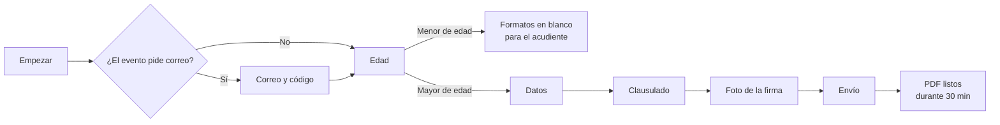
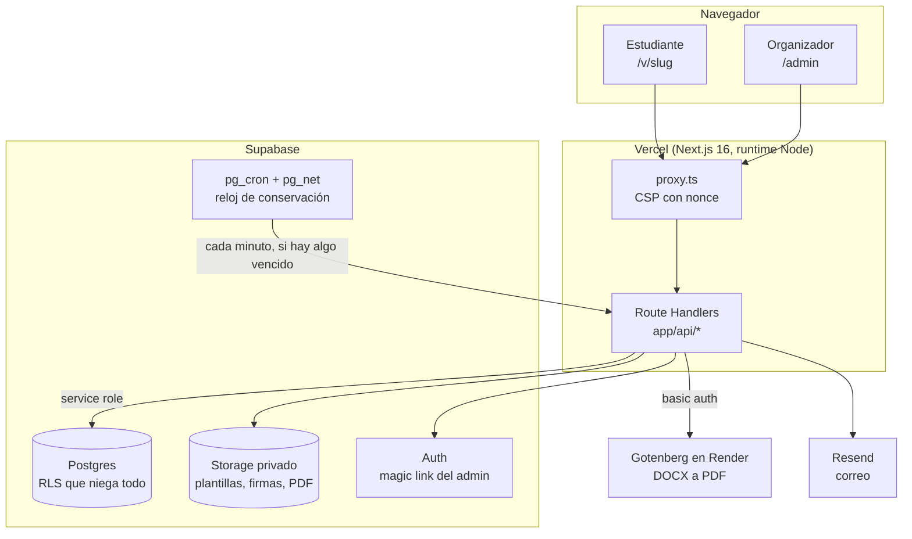
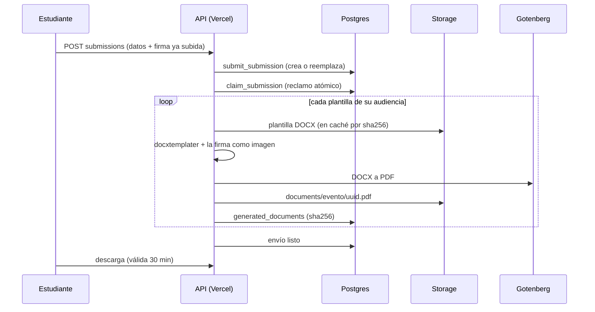

# ARIA: cómo funciona y por qué

ARIA (Academic & Industrial Visit Assistant) es la plataforma con la que los estudiantes de
Ingeniería Mecánica de la Universidad del Norte diligencian y firman, desde el celular, los formatos
de una salida de campo o visita a empresa. **No es un sistema oficial de la Universidad**: la opera
el organizador de las visitas, y la Universidad no figura como responsable de los datos.

Este documento explica cómo está hecha y, sobre todo, por qué. El cómo se levanta en local está en
el [README](README.md); cada decisión, con su fecha y su motivo, en [DECISIONS.md](DECISIONS.md).
Aquí se cuenta el sistema completo para que alguien que no lo construyó pueda entenderlo,
cambiarlo sin romperlo y defenderlo.

## 1. El problema

¿Qué pasa antes de cada visita? Cada estudiante tiene que llenar los mismos anexos (el formato de la
actividad, el de autorización, el de salud y contacto de emergencia), firmarlos y entregarlos; el
organizador, por su parte, tiene que recogerlos, revisar que no falte ninguno y perseguir a quien no
los entregó. Son los mismos datos repetidos en varios papeles, y entre ellos hay datos sensibles:
alergias, condición médica, EPS y número de documento.

ARIA hace dos cosas. El estudiante escribe sus datos **una sola vez** y salen en todos los formatos;
y el organizador ve en un panel quién ya envió y descarga los PDF. Lo segundo no vale nada sin lo
primero, y lo primero no se podía hacer a costa de los datos: por eso la conservación (sección 7)
pesa tanto como el formulario.

## 2. Quién la usa

**El organizador** entra al panel (`/admin`) con un enlace que le llega al correo. Sube las
plantillas de Word de los anexos, crea un evento (lugar, fecha, docente responsable, transporte,
quién lo aprobó), lo publica y comparte el enlace o el código QR. Durante la ventana del evento ve
los envíos, descarga los PDF y regenera los que se trabaron.

**El estudiante** abre `/v/<slug>` en el celular. El recorrido está en `app/v/[slug]/flow.tsx` y
avanza por pasos:

El menor de edad no firma en línea: sus formatos los firma el acudiente, así que ARIA le entrega los
anexos en blanco para imprimir. Habilitar a los menores en digital (`minors_digital_enabled`) está
apagado hasta que exista una aprobación escrita.

El correo es opcional por evento (`events.require_email`) y viene apagado. La razón es práctica: sin
un dominio verificado, Resend solo le entrega correos al dueño de la cuenta, así que un código
nunca llegaría a un correo institucional. Sin correo, el estudiante pulsa "Empezar" y recibe una
sesión atada a ese navegador.

## 3. Las piezas

La regla que ordena todo el diagrama: **el navegador nunca habla con Supabase**. No existe ninguna
variable `NEXT_PUBLIC_SUPABASE_*`; el servidor usa la service role (`lib/server/db.ts`) y todas las
tablas tienen RLS activada sin una sola política, más un `revoke all` para `anon` y
`authenticated`. Si una clave pública se filtrara, no abriría nada. El CI lo comprueba buscando
claves de Supabase en `.next/static`.

| Pieza | Para qué | Dónde se ve |
|---|---|---|
| Next.js 16 (App Router) | Páginas y API en un solo proyecto | `app/` |
| Supabase Postgres | Eventos, envíos, plantillas, auditoría | `supabase/migrations/` |
| Supabase Storage | Plantillas, firmas y PDF, en buckets privados | `lib/server/db.ts` (`BUCKETS`) |
| docxtemplater | Llenar las plantillas de Word | `lib/server/docs.ts` |
| Gotenberg 8 | Convertir el DOCX en PDF con LibreOffice | `lib/server/pdf.ts`, `render.yaml` |
| sharp | Procesar la foto de la firma | `lib/server/signature.ts` |
| Resend | Códigos y magic link | `lib/server/mail.ts` |
| Cloudflare Turnstile | Frenar bots en "Empezar" | `app/v/[slug]/turnstile.tsx` |

## 4. Los datos

| Tabla | Qué guarda |
|---|---|
| `admins` | La lista de correos que pueden entrar al panel. El registro público está apagado |
| `templates` | Cada plantilla subida, versionada e inmutable (un trigger impide editarla): tipo (`per_submission` o `per_event`), audiencia (`all`, `adult`, `minor`), marcadores detectados y su `sha256` |
| `events` | El evento, su estado (`draft`, `open`, `closed`, `archived`), su ventana y lo que el organizador deja cargado |
| `event_templates` | Qué plantillas usa cada evento |
| `submissions` | Un envío por estudiante: sus datos, su dueño (`owner_key`) y su estado de generación |
| `generated_documents` | Cada PDF generado, con su `sha256`. Cuando el archivo se borra, la fila queda como lápida |
| `email_otps` | Los códigos de correo, con la IP para contar los intentos |
| `roster` | La lista de inscritos de un evento, para cuando se exija |
| `audit_log` | Lo que pasó y quién lo hizo, sin datos personales. Solo admite inserciones |

**El dueño de un envío** es el correo verificado o, sin correo, la sesión del navegador
(`sesion:<uuid>`). Todo acceso a un envío compara ese dueño con la sesión, así que conocer el `id`
de un envío ajeno no sirve de nada.

**¿Qué pasa si dos personas envían la misma cédula?** Si fuera la misma sesión, el envío nuevo
reemplaza al anterior: es una corrección. Si es otra sesión, no se reemplaza nada, porque cualquiera
con el enlace y la cédula de otro podría pisarle su formato; quedan los dos marcados como
"Documento repetido" y el organizador decide. Toda esa lógica vive en una sola función de Postgres,
`submit_submission`, que además serializa los envíos de un mismo dueño con un candado y respeta la
`Idempotency-Key`: si el celular reintenta, no se crea un segundo envío.

## 5. De un envío a sus PDF

El pipeline está en `lib/server/generate.ts`:

Tres detalles sostienen esto. **El reclamo atómico** (`claim_submission`) impide que dos procesos
generen el mismo envío a la vez, y permite reintentar: un envío trabado se vuelve a intentar cuando
el estudiante lo consulta. **El caché por `sha256`** funciona porque una plantilla nunca cambia; una
versión nueva es otra fila. **Gotenberg duerme**: Render en plan gratis lo apaga tras 15 minutos sin
tráfico, y despertarlo tarda alrededor de un minuto, así que la app le toca `/health` apenas un
estudiante abre el evento, y mientras llena el formulario el servicio arranca.

La firma tiene su propio proceso (`lib/server/signature.ts`). El navegador reduce la foto, le quita
el EXIF y convierte HEIC; el servidor separa la tinta del papel con un umbral de Otsu, recorta a la
tinta y guarda un PNG transparente. La foto original nunca se guarda.

## 6. Seguridad

- **Admin sin Supabase en el navegador.** El servidor pide el magic link, y solo si el correo está en
  `admins` (la respuesta es la misma en ambos casos, para no revelar quién es admin). El enlace abre
  una página con un botón, y la sesión se crea con ese POST: así un escáner de correo que abre los
  enlaces no consume el inicio de sesión.
- **Sesión del estudiante firmada con HMAC-SHA256** (`lib/server/session.ts`), en una cookie
  `__Host-` HttpOnly de 2 horas, atada al evento y al dueño. No hay estado en la base; un token de
  tres campos no justificaba una dependencia.
- **Límites del código de correo contados en Postgres**: hasta 3 códigos por hora por correo y 10 por
  IP. La base ya es compartida entre instancias, así que no hizo falta otro servicio.
- **Topes contra el abuso del formulario** (`SUBMISSION_LIMITS` en `lib/server/submissions.ts`): un
  envío y 5 correcciones por dueño y evento, 150 envíos por hora por IP y 20 firmas guardadas a la
  vez. El tope por IP es alto a propósito, porque un salón entero sale por el mismo Wi-Fi. Las rutas
  públicas que leen JSON responden 413 por encima de 64 KB.
- **CSP con nonce y `strict-dynamic`** (`proxy.ts`): solo corre lo que cargó un script con nonce,
  nadie puede enmarcar la página y no se admiten `object` ni `base`.
- **En CI**: gitleaks sobre toda la historia, las migraciones aplicadas desde cero y los tipos de la
  base al día.

## 7. Conservación: los datos sensibles viven 30 minutos

Después de generar los PDF, ¿para qué seguir guardando las alergias de alguien? Solo para prellenar
una corrección, y eso no justifica el riesgo. Por eso, 30 minutos después de generarse los PDF:

1. se borra cada PDF, y su fila queda como lápida con el `sha256` (sirve para comprobar que un PDF
   entregado es el original);
2. se borra la imagen de la firma;
3. del envío se borran el número de documento, la EPS, las alergias, la condición médica y el
   contacto de emergencia, y queda marcado con `data_purged_at`.

Queda la constancia: quién envió, cuándo y qué aceptó. Un envío que nunca terminó se vacía a las 72
horas, una firma que nunca llegó a un envío a las 2 horas y los códigos de correo a las 24. Los
plazos están en `lib/shared/retention.ts`.

**El reloj vive en la base.** `pg_cron` corre cada minuto y, solo si hay algo vencido, llama con
`pg_net` a `POST /api/internal/purge-documents` con una clave guardada en Vault. Se descartaron el
cron de Vercel (en el plan gratis corre una vez al día) y el de GitHub Actions (se atrasa y se apaga
en repos inactivos). El borrado es idempotente porque siempre va primero el archivo y después la
fila: si una corrida falla a la mitad, la siguiente la termina sin dejar archivos sin dueño. Y los
archivos se borran por la API de Storage, nunca con SQL sobre `storage.objects`, que borraría el
registro y dejaría el archivo.

El costo se aceptó a sabiendas: nadie recupera un PDF vencido, y ARIA no sirve para consultar una
alergia el día de la salida. Para eso están los PDF que el organizador ya descargó.

## 8. Despliegue y pruebas

Cada merge a `main` despliega solo por la integración de Vercel con GitHub. Lo que el merge no
cambia (migraciones, configuración de Auth, variables, la clave del reloj) lo aplica el workflow
**Producción**, que se corre a mano y termina con pruebas de humo contra producción. Una migración
se escribe para que el código anterior siga funcionando y se aplica **antes** del merge; el orden
completo está en el README.

| Nivel | Qué cubre | Cómo corre |
|---|---|---|
| Unitarias | Render de plantillas, firma, validador, texto legal, conservación | `npm test` |
| Integración | RLS, Storage, flujo del estudiante, plantillas, borrado de eventos | Supabase local + Gotenberg + poppler |
| E2E | Panel y estudiante en Chromium, sin violaciones de la CSP | Playwright |

## 9. Lo que falta

- **Claves reales de Turnstile.** Producción usa las de prueba de Cloudflare, que no frenan a ningún
  bot. Van antes del piloto.
- **Dominio verificado en Resend.** Sin él, el correo del estudiante tiene que seguir apagado.
- **El borrado de la constancia** 90 días después de la salida: `retention_until` ya se calcula,
  pero nada lo lee todavía.
- **La dirección y el teléfono de los responsables** en el aviso de privacidad, pendientes de la
  revisión de un abogado.
